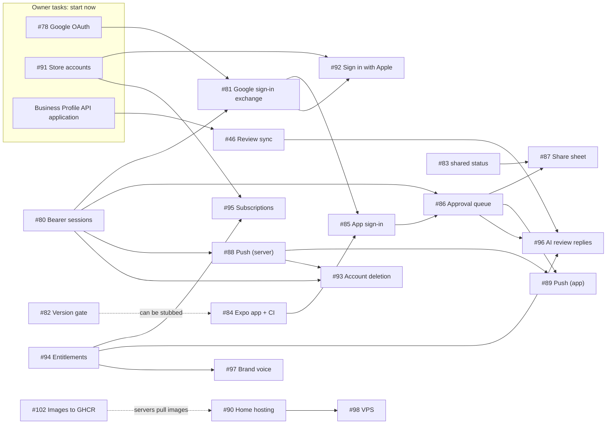

# Mobile-first plan

Status: accepted 2026-10-26 (#79). Tracking issue: #99.

PraiseLoop becomes a phone app for business owners, backed by the server that
already exists. The server keeps doing the hard work (review import, quote
selection, AI captions, image rendering, the weekly job and the approval rules).
The app is where the owner meets the product: a notification that this week's
posts are ready, a queue to approve them, and one tap to post.

## Why change

- **Owners live on their phones.** They won't open a laptop every week to approve
  posts, but they will tap a notification. The approval queue is the most
  natural screen in the product, and it fits a phone.
- **Real posting has been blocked for months.** #29 (Buffer) waits on provider
  access, an encryption key, public media and a live test. The phone's share
  sheet lets the owner post the approved image and caption to Instagram or
  Facebook themselves, today, with no provider integration.
- **The value isn't the caption.** Anyone can paste a review into a chatbot. The
  product is that a ready, on-brand post appears every week without anyone
  thinking about it, and AI does the chores owners hate (captions now, review
  replies next).
- **It has to start cheap and earn money later.** Hosting starts at about $0 on
  an existing home server; paid feature unlocks come once the pilot shows people
  use it.

## Goals

1. An owner can approve and post a week of content from their phone in under five
   minutes, starting from a push notification.
2. The pilot runs for about $0 a month in hosting, plus the app store fees.
3. Paid features can be switched on per business without code changes.
4. Every existing guarantee holds: owner isolation, human approval before
   anything is posted, audit events, bounded AI spend.

## Non-goals (for now)

- Rebuilding setup in the app. Onboarding, branding and CSV import stay on the
  web until the pilot shows owners need them on the phone.
- Automatic posting. Approval stays required ([decisions](decisions.md)).
- Direct publishing integrations (Buffer, Meta APIs). #29 moves to a later paid
  feature; the share sheet replaces it for the MVP.
- Offline use beyond showing the last loaded queue.
- Teams and roles. One owner per business, as today.

## Product shape

| Surface | What the owner does there |
|---|---|
| **Phone app** (new) | Sign in · get "N posts ready" notifications · review the weekly queue · edit a caption · approve or archive · post through the share sheet · (paid) approve AI review replies |
| **Web app** (existing) | Onboarding · brand colours, logo and tone · CSV import · posting slots · everything else |
| **Server** (existing) | Review import and sync · quote selection · captions · rendering · weekly generation · push sending · entitlements |

The weekly loop on a phone:

1. Monday, the worker finishes the business's weekly drafts ([generation](features.md#durable-weekly-generation-43)).
2. The server sends a push notification: "3 posts are ready to review."
3. The owner opens the app on the queue, edits a caption if needed and approves.
4. For each approved post they tap **Post**. The app saves the image, copies the
   caption and opens the share sheet; they pick Instagram or Facebook and post.
5. The app marks the draft **shared**. The server records it as owner-reported,
   never as a verified publication.

## Architecture

### Mobile app

- **Expo (React Native, TypeScript)** in a new `mobile/` directory with its own
  `package.json` and lockfile. One codebase for iOS and Android, built with EAS
  Build or locally. The web app's dependencies and build are unaffected.
- The app talks only to our API, like the web UI ([architecture](architecture.md)).
  It never calls OpenAI, Google review APIs or social networks directly.
- Session tokens live in the platform keychain (`expo-secure-store`), never in
  plain storage.
- CI gets a separate job for `mobile/`: lint, typecheck and unit tests.

### Server changes

**Bearer sessions for the app** (#80). `ownerRoute` reads only the NextAuth
cookie today and rejects any write whose `Origin` isn't `NEXTAUTH_URL`. Native apps
send no cookie and no matching `Origin`. The guard will also accept
`Authorization: Bearer <token>`, looked up in the same hashed `auth_sessions`
table. The same-origin check stays for cookie requests, where it guards against
CSRF; bearer requests don't need it, because a browser never attaches the token
automatically. App sessions last longer than the web's eight hours, are revocable,
and end on sign-out. Every existing route, ownership check and limit applies
unchanged.

**Google sign-in from the app** (#81). The app uses native Google
Sign-In and sends the Google ID token to a new `POST /api/mobile/session`
endpoint. The server checks the token's signature, issuer, expiry, verified email
and audience (our iOS and Android client IDs). It then finds or creates the owner
through the same `auth_accounts` row the web uses (`provider = google`, the
token's `sub`), so the same person sees the same businesses on both. It returns
a new bearer session. The server stores no Google tokens, as today.

**Email sign-in from the app** (#157). The sign-in screen offers the same email
one-time code as the web: the app requests a code, the server sends it, and a
verified code returns a normal bearer session (`POST /api/mobile/session/email`).
A wrong code is a 400, not a 401, so a typo never clears the app's stored token.
The address can belong to an existing Google owner; the linking policy lives in
`docs/auth.md`.

**Sign in with Apple** (#92). App Store guideline 4.8 expects an app that
offers Google sign-in to also offer an equivalent private option. Sign in with
Apple is added to the app and to the web (NextAuth), so an owner who signs up on
an iPhone can also use web setup. Needed before public App Store release, not for
TestFlight.

**Version gate** (#82). Installed apps can't be forced to update.
`GET /api/mobile/config` returns the minimum supported app version and feature
flags; the app shows an "update required" screen below it. API changes the app
uses must be additive; breaking changes need a new route.

**Shared status** (#83). A new draft status, `shared`, means "the owner
says they posted this from their phone." It comes after `approved`, is recorded
in `draft_events` like every other transition, and is never shown as a verified
`published`. Migration required.

**Push notifications** (#88, #89). A `device_push_tokens` table
(owner, Expo push token, platform, last seen). The worker sends "posts ready"
through the Expo push service when a business's weekly drafts are complete, and
removes tokens that Expo reports as no longer registered. Notifications carry no
review text or captions, only a count and a deep link to the queue.

**Entitlements** (#94). A per-owner plan (`free` or `pro`) with
limits checked on the server: posts per week, templates, watermark, review sync,
AI replies, number of businesses. Owner-level storage is what makes "more than
one business" enforceable; every owned business inherits the plan. Store purchases
change the plan through a verified webhook (#95); the app never decides what's unlocked.

**Account deletion** (#93). App Store guideline 5.1.1(v) requires apps that
create accounts to let users delete them in the app. Deleting an owner removes
their sessions, push tokens, businesses, reviews, drafts and media, with a
confirmation step.

### Posting through the share sheet

- The app downloads the approved PNG through the owner-protected media route
  (bearer session), copies the caption to the clipboard, then opens the system
  share sheet with the image.
- Instagram doesn't accept caption text from other apps, so the owner pastes it.
  The app says so on the button ("Caption copied — paste it in Instagram").
  Verify the behaviour of Instagram and Facebook on both platforms in #87.
- The media stays private. Nothing is made public for a provider to fetch, so
  #29's capability-URL work isn't needed for the MVP.

## AI features

AI is part of the product's pitch. Each feature keeps human approval and the
existing per-owner daily limits.

| Feature | Status | Plan |
|---|---|---|
| Captions in the brand voice | Shipped | Free, with paid extras (more variants per post) |
| Draft replies to Google reviews | #96 | Paid. Needs #46. Owners are told to reply to every review and few do; the app drafts each reply and the owner approves it before it's posted through the Business Profile API |
| Brand voice from the owner's website | #97 | Paid, later. Replaces the tone dropdown with a short voice profile |
| AI help picking quotes | Idea | Later, if deterministic selection proves weak in the pilot |

Posting replies changes [integrations.md](integrations.md)'s current stance that
the Business Profile connector stays read-only. #96 records that decision
before any write call.

## Plans and pricing

Pricing is set after the pilot. The split, to start:

| Free | Pro (monthly) |
|---|---|
| CSV import | Automatic Google review sync (#46) |
| 1 post a week | 3–5 posts a week |
| One template, small watermark | All templates, no watermark |
| Captions | AI review replies, brand voice |
| | More than one business |

- Purchases go through App Store and Google Play subscriptions. Both take about 15%
  from small developers. A billing service such as RevenueCat can handle both
  stores and send one webhook; the choice is recorded in #95, stubbed
  first as the [contributing rules](../CONTRIBUTING.md) require.
- A web checkout (for example Stripe) can come later for owners who sign up on the
  web. It isn't needed for the pilot.
- The public `/plans` page (#134) shows only the enforced limits, with no prices,
  until the Free/Pro prices are recorded in `docs/decisions.md`.

## Hosting

| Stage | Where | Cost | When |
|---|---|---|---|
| Pilot | The existing home server, running the current `docker compose` stack, exposed through a Cloudflare Tunnel (no open ports) | About $0 | Now (#90) |
| Paying customers | A small VPS running the same stack | About $5–10 a month | When the first business pays or home uptime isn't good enough (#98) |

Either way the app reaches one HTTPS API URL. Moving hosts is a DNS change, not an
app release. Both stages need nightly Postgres and media backups kept off the
machine, and a tested restore.

Other running costs: OpenAI captions cost fractions of a cent per post and are
capped by `OWNER_GENERATION_DAILY_LIMIT`. Apple Developer Program: $99 USD a year.
Google Play: $25 once. Expo's push service is free. EAS Build has a free tier;
local builds also work.

## Delivery phases

Each phase ends with something an owner can use. Issues follow the
[contributing rules](../CONTRIBUTING.md): one PR per issue. Phases group the work
by theme; [Order of work](#order-of-work) says what has to wait for what.

### Phase 0: groundwork

- #79 Docs cleanup and this plan
- #78 Google OAuth setup for web sign-in (owner)

### Phase 1: server support for the app

- #80 Bearer sessions in the owner guard
- #81 Google sign-in exchange for the app
- #82 Mobile config and minimum-version gate
- #83 `shared` draft status

### Phase 2: the app

- #84 Expo app in `mobile/`, with CI
- #85 Sign in, sign out, secure token storage
- #86 Weekly approval queue
- #87 Post through the share sheet
- #88 Device registration and "posts ready" notifications (server)
- #89 Notification permission, registration and deep link (app)

### Phase 3: pilot

- #90 Home-server hosting through Cloudflare Tunnel, with backups
- #102 Build and push the web and worker images to GitHub Container Registry
- #91 App Store and Google Play accounts, privacy policy, test builds (owner)
- #92 Sign in with Apple, before public App Store release
- #93 Account deletion
- Pilot with the first businesses through TestFlight and Play internal testing, using
  the [pilot](pilot.md) process

### Phase 4: revenue and AI

- #94 Plans and server-enforced entitlements
- #95 In-app subscriptions
- #46 Google Business Profile review sync, now Pro's main feature
- #96 AI review replies

### Later

- #97 Brand voice from the owner's website
- #98 Move production to a VPS
- #29 Scheduler integration, as an optional Pro feature for automatic posting
- Setup screens in the app, if the pilot shows owners want them

## Order of work

Only the arrows below are real dependencies. Anything not waiting on an arrow can
be worked on in parallel.

### Waves

| Wave | Work (everything in a wave can run in parallel) | Waits for |
|---|---|---|
| **Now** | #101 CI test fix (in #100) · #102 images to GHCR · #80 bearer sessions · #82 version gate · #83 `shared` status · #84 Expo app · #90 home hosting · #94 entitlements | Nothing |
| **Now (owner)** | #78 Google OAuth · #91 store accounts · Business Profile API application (steps in #91) | Nothing; these have the longest waits, so start them first |
| **2** | #81 Google sign-in exchange · #88 push (server) | #80 (and #78 for a live #81 test) |
| **3** | #85 app sign-in | #81, #84 |
| **4** | #86 approval queue | #85 |
| **5** | #87 share sheet · #89 push (app) · #93 account deletion | #86, #83, #88 |
| **Pilot** | First businesses on TestFlight and Play internal testing | Waves 1–5 and #90 |
| **Before public release** | #92 Sign in with Apple; for a personal Play account, a 14-day closed test with at least 12 testers | #81, #91; the closed test can start as soon as wave 4 produces a build |
| **Revenue** | #95 subscriptions · #97 brand voice | #94, and #91 for store products |
| **When Google approves** | #46 review sync, then #96 AI review replies | Business Profile API approval; #94 and #86 for #96 |
| **Later** | #98 VPS · #29 scheduler | #90 for #98; demand for #29 |

The critical path to the pilot is **#80 → #81 → #85 → #86 → #87**. The waits
outside the code are just as long: Apple organization enrolment (a D-U-N-S number
takes up to a week), the Play closed test (14 days) and Google's API review
(weeks). That's why the owner tasks belong in the first wave.

## Risks and open questions

- **Google Business Profile access is gated.** Google requires the applying
  developer to manage a verified profile that's at least 60 days old, with a
  website ([integrations](integrations.md#google-business-profile-feasibility-46--checked-2026-10-15)).
  A pilot business where the developer is a profile manager could satisfy this.
  Apply early; approval can take weeks.
- **Google's content policy may limit review reuse.** The API policies cap cached
  content and restrict changing it. Turning reviews into social graphics needs
  Google's clarification before sync ships. CSV import remains the fallback.
- **App Store review.** Apple can reject thin apps that wrap a website (guideline
  4.2). The phone flow (notifications, approval, share sheet) is native, but setup
  being web-only may draw questions. Sign in with Apple (4.8) and account deletion
  (5.1.1(v)) are planned for that reason.
- **Share sheet limits.** Caption pasting is a manual step, and behaviour differs by
  app and platform. If owners drop off there, #29 (automatic scheduling) becomes
  the Pro answer.
- **Home hosting uptime.** A power or internet outage at home takes the pilot
  down. Acceptable for a pilot with a few businesses; the VPS move is the fix.
